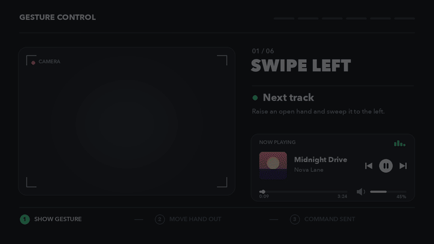

# Spotify Gestures

A native macOS menu bar app that watches the camera only while its window is open, recognizes six hand gestures, and sends AppleScript commands to the installed Spotify app. It combines the hand-pose model trained on `augmented_vids` with a locally trained Jester video model.

<p align="center">
  
</p>

Regenerate the guide with `python Tools/create_gesture_tutorial.py` (needs Pillow and ffmpeg).

## Build and run

On an Apple silicon Mac with Xcode command line tools:

```sh
./build.sh
open "dist/Spotify Gestures.app"
```

The app stays in the menu bar. Press **Command+Shift+O** to open its camera window and start recognition. Show a gesture and then move your hand out of view; the app classifies the complete motion and sends the command. Press **Command+Shift+C** to close the window and stop the camera. The menu bar icon offers the same controls, a **Launch at Login** option, and Quit. For login launch, move the app to `/Applications` first.

macOS asks for camera access the first time the window opens, then remembers the choice. It also asks for permission to control Spotify the first time a gesture sends a command. The app cannot bypass these system prompts. All video processing happens on the Mac; frames are not sent over the network or saved.

| Gesture label | Spotify action |
| --- | --- |
| `swipe_next` | Next track |
| `swipe_previous` | Previous song, including when Spotify would otherwise restart the current one |
| `stop` | Pause |
| `play` | Play |
| `volume_up` | Increase Spotify volume by 10 |
| `volume_down` | Decrease Spotify volume by 10 |

Gestures need a visible hand and roughly the same direction as the training videos. Hold an open palm briefly for Pause and give a thumbs-up for Play. Move your hand out of view between commands; this resets the detector and prevents repeated commands from one motion. The video model handles clear motion, while the hand-pose model protects Pause when an open palm resembles a thumbs-up to the video model.

If left and right gestures are reversed, toggle **Mirror Gesture Directions** in the menu bar menu.

## Retrain

Run `./build.sh --train` after adding or replacing clips in `augmented_vids/<label>/`. The training tool extracts hand position and shape with Apple's Vision framework and saves complete gesture examples to `Resources/GestureModel.json`. The app compares each live gesture with these examples; it does not require Python or an internet connection. If the local Core ML video model is present under `Data/jester/finetune/r3d18_full_frame/`, `build.sh` includes it in the app; otherwise the app uses the hand-pose model alone.

An offline evaluation that excluded all augmentations of each held-out original clip reached **85.5%** accuracy for the base classifier on the 456 clips with enough detectable hand frames. Replaying the 26 isolated source clips through the current action rules recognized 24; two had too few detected hand frames. These numbers do not measure performance on a new live camera recording.

## Jester dataset experiment

The research experiment uses six command gestures from [Qualcomm Jester](https://www.qualcomm.com/developer/software/jester-dataset): `Swiping Left` → next, `Swiping Right` → previous, `Swiping Up` → volume up, `Swiping Down` → volume down, `Stop Sign` → pause, and `Thumb Up` → play. It also learns `No gesture` and `Doing other things` as ignore classes.

The scripts use only selected clips from the first 4 GiB of Jester's 22.8 GB gzip archive. Training examples come from Qualcomm's `train.csv`; 240 clips from `validation.csv` are held out. The first trials used a frozen Kinetics-400 R3D-18 encoder, optical flow, and an SVM. The improved `Tools/jester_finetune.py` updates the video network's final layers on 5,000 clips and keeps the full frame visible during swipes. `Tools/jester_export_coreml.py` converts the best checkpoint to Core ML for the Mac app. Model reports and data are in the ignored local `Data/jester/` directory. Install the Python dependencies with `pip install -r requirements-jester.txt` to rerun the experiment.

Held-out eight-class accuracy was **45.4% (109/240)** with 1,000 clips and **56.25% (135/240)** with 5,000 clips using the frozen encoder. Fine-tuning with the same 5,000 clips reached **86.25% (207/240)** at the best epoch. The full-precision Core ML export matched 207/240. On the 26 short clips from `transformed_vids`, the Swift video model and the existing hand-pose model together selected the correct action on all 26. These clips come from a small number of original recordings, so this replay does not measure new live-camera accuracy. The confusion matrices and checkpoints are saved in `Data/jester/`.

[Qualcomm's license](https://www.qualcomm.com/content/dam/qcomm-martech/dm-assets/documents/jester_something_something_exercise_research_license_final_qti_28jul2022.pdf) limits the dataset and resulting models to internal, non-profit research use. Do not redistribute the clips or use these trained models in a released app without resolving those terms.
